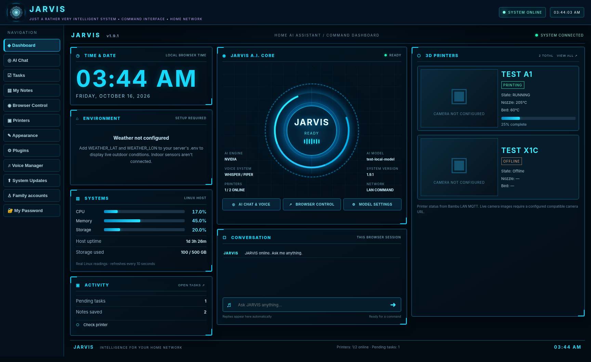

# JARVIS ONE — Your Self-Hosted AI Command Center

**Your AI. Your Home. Your Control.**



JARVIS ONE combines a neon-cyan command dashboard, voice interaction, cloud AI model choice, browser automation, and **read-only Bambu Lab 3D-printer monitoring** in a self-hosted Ubuntu/Docker application. Run it on your own Linux server and access its web interface from devices on your trusted network.

> **Release:** v1 · **Platform:** Ubuntu/Linux with Docker Compose · **License:** MIT  
> **Status:** Personal/community v1 release. Test in your environment before relying on automation or monitoring. The image above is an illustrative demonstration, not live printer telemetry.

## What can it do?

| Capability | What you get |
| --- | --- |
| **Cyan Command HUD** | Animated JARVIS core; large clock; Linux CPU/memory/disk/uptime; task overview; responsive desktop/mobile interface |
| **“Hey JARVIS” voice** | Optional browser-tab wake listening, randomized spoken acknowledgment, and follow-up speech commands with Whisper/Piper |
| **AI chat** | Use administrator-approved NVIDIA or OpenRouter model IDs with your own API key |
| **Browser Control** | Launch/search public HTTPS websites in a server-hosted Chromium browser, not your desktop Chrome |
| **3D printer monitoring** | Bambu Lab LAN/MQTT status, temperatures, progress and optional compatible camera URLs |
| **Live outdoor weather** | Configure latitude/longitude in Appearance (admin); Open-Meteo conditions; no manual `.env` edit required |
| **Per-user time zones** | Automatic/browser or IANA time zone selection |
| **Household accounts** | Admin/family accounts, notes, tasks and personal preferences |
| **Extensions and updates** | Plugin support and local ZIP-updater with backups of replaced source files |

**What it does not do:** It does not provide a native Windows desktop controller, control all smart-home devices out of the box, guarantee hands-free wake listening with a closed browser, or expose indoor sensor readings without a connected sensor. Only features with configured external services show real data.

## Get running (Ubuntu)

**Prerequisites:** Docker Engine + Docker Compose plugin, Python 3, an Ubuntu/Linux host, and outbound internet access to download dependencies. A machine with enough memory to run Chromium and speech recognition is recommended. Your user must be allowed to run Docker (`docker compose version` should work).

```bash
# Replace YOUR_GITHUB_USERNAME with the account where you publish this repository.
git clone https://github.com/YOUR_GITHUB_USERNAME/jarvis-one-ai-command-center.git
cd jarvis-one-ai-command-center
python3 setup.py
docker compose up -d --build
docker compose ps
```

`setup.py` generates a **unique administrator password** on first run and creates a private printer configuration file. **Save the password** displayed in the terminal. For AI responses, open `.env` locally and supply your OpenRouter or NVIDIA key (no key is bundled); then use `docker compose up -d --force-recreate jarvis`. Without an AI key, dashboard features still work but hosted-model chat will be unavailable.

Open `http://YOUR_SERVER_LAN_IP:8765` from your trusted LAN and sign in using the generated credentials. **Do not expose the default HTTP port to the public internet.** Use a properly configured HTTPS reverse proxy and access controls if remote access is needed.

[Detailed Ubuntu installation](docs/INSTALL_UBUNTU.md) · [Upgrade an existing JARVIS](docs/UPGRADE.md) · [Configuration](docs/CONFIGURATION.md) · [Security](SECURITY.md) · [Troubleshooting](docs/TROUBLESHOOTING.md)

## Enable voice and wake-word greeting

Open **AI Chat**, allow microphone permission, and opt into **Enable “Hey JARVIS.”** Say “Hey JARVIS”, wait for one of the greetings, then speak the command. For example:

> “Hey JARVIS” → “At your service. What can I do for you?” → “Open YouTube.”

Voice wake listening runs in a **browser tab** using short transcription clips; it is **not a background OS hotword service**. The tab must be open. Remote browsers generally require HTTPS for mic access; autoplay may require a tap/click first. [Voice setup](docs/CONFIGURATION.md#voice-and-microphone)

## Configure weather without touching `.env`

Sign in as an administrator → **Appearance → Weather settings** → enter latitude and longitude and save. The setting persists in the private `data/` directory. Live outdoor readings come from Open-Meteo when internet connectivity is available. Indoor temperature needs separate hardware/integration.

## Connect a 3D printer

Copy/edit `config/printers.json` (generated by `setup.py`) with your printer LAN address and serial, then set the matching `BAMBU_*_CODE` environment variable in your local `.env`. Restart the JARVIS container so it reads the code. **Never commit access codes or private camera URLs**. Printer integration is read-only. [Configuration](docs/CONFIGURATION.md#bambu-lab-printers)

## Update JARVIS

Existing users should use the **separate, updater-compatible release asset** `JARVIS_v1_FULL_UPDATE.zip` in **System Updates**, or stage it in `data/updates/` and run:

```bash
python3 apply_update.py --file data/updates/JARVIS_v1_FULL_UPDATE.zip
```

The public GitHub **source-code ZIP is not an updater ZIP**; do not upload the source archive to the in-app updater. See [upgrade instructions](docs/UPGRADE.md) for backups and rebuilding containers.

## Contributing and support

This is a community-friendly starting point. Issues and contributions are welcome after the repository is published. See [CONTRIBUTING.md](CONTRIBUTING.md) and [SECURITY.md](SECURITY.md); never post credentials, `.env` files, Docker volumes, or private LAN screenshots in issues.

**Tagline:** *JARVIS ONE — Turn your Linux server into an AI command center.*
